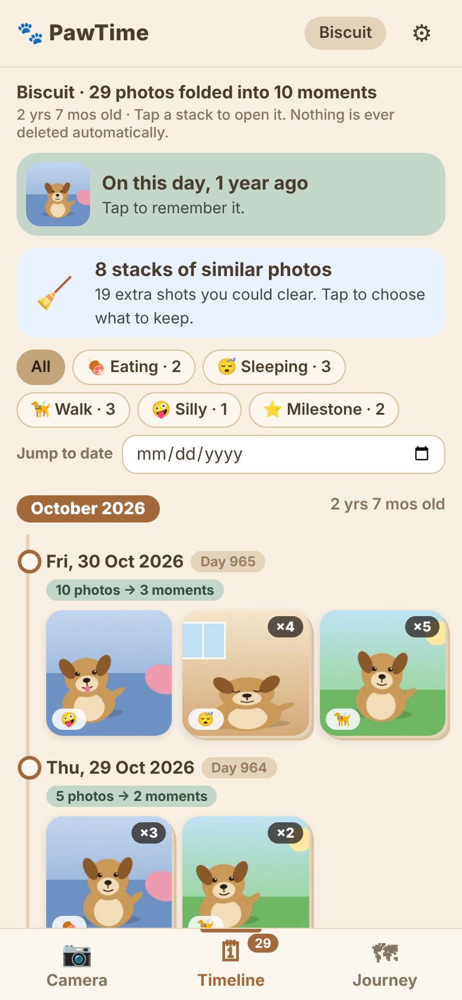
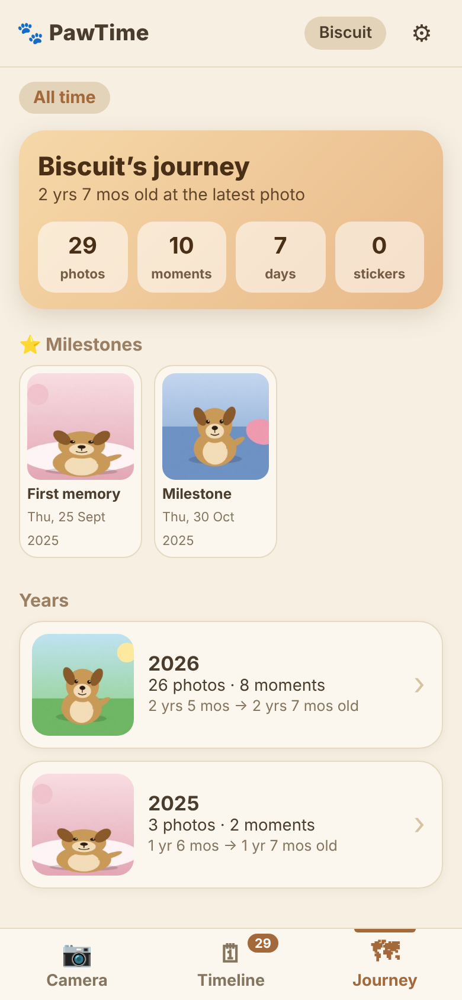
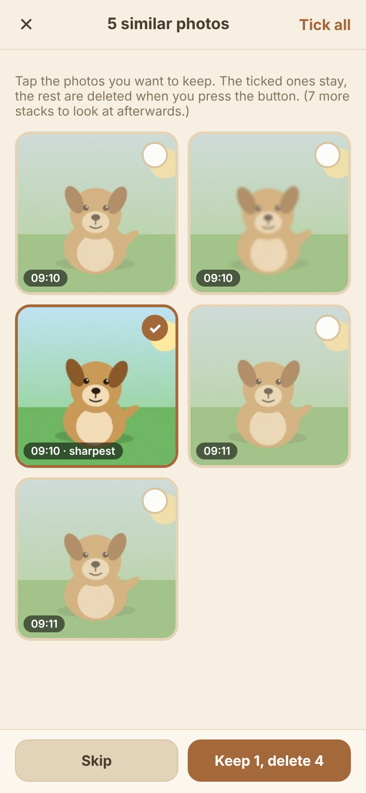
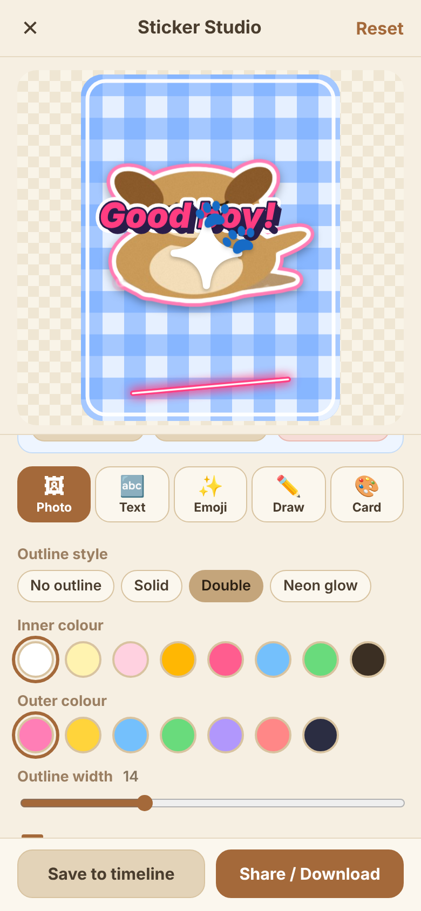

# PawTime 🐾

**Shoot to save, and your pet's photos organise themselves into a growth timeline.**

A phone-installable web app (PWA) for pet owners whose camera roll is full of dozens of near-identical pet photos they can't bear to delete, and can never find again. It also makes pet stickers: automatic cut-out with outline, patterned cards, text, emoji and freehand drawing.

- **Live app:** `https://<your-github-username>.github.io/<repo-name>/`  ← *(fill in after enabling GitHub Pages)*
- **Screen recording:** *(add a short phone recording here, e.g. `docs/demo.mp4`)*
- Course: SD5911, Assignment 3 (An interactive experience). Individual project.

| Timeline | Journey (big picture) | Choose what to keep | Sticker Studio |
|---|---|---|---|
|  |  |  |  |

*Screenshots use the app's built-in sample pet photos (drawn in code), not real animals.*

---

## The idea

I take photos of my pet all the time. The result: my phone album is stuffed with dozens of shots that barely differ, I can't make myself delete any of them, and when I want one specific moment it is buried among everyday photos.

PawTime's answer is **fold, don't delete**:

1. **Shoot inside the app.** Take photos, or switch to **Video** and record clips of up to one minute. They go into PawTime's own storage, not the phone gallery, so pet memories stay separate from screenshots and receipts.
2. **Similar shots fold into one "moment".** Photos that look alike and were taken close in time become a single stack, even when you took them as separate shots a few minutes apart. The sharpest shot becomes the cover. Nothing is deleted unless you choose to, and a **"Choose what to keep"** screen lets you tick the ones you want.
3. **Everything lands on a growth timeline** (month → day → moment) that shows your pet's age and "Day N", filters by tag, and jumps to any date. A **Journey** page zooms out to the big picture: years → months → days.
4. **Turn a favourite into a sticker:** cut the pet out of the photo with an automatic coloured outline, put it on a patterned card, add as many emoji, decorations and caption texts as you like, draw on it, and share it.

### Intended user
Pet owners (roughly 20–35) who treat their pets as family, photograph them constantly, and like sharing stickers and memories on chat apps and social media.

### Main interaction (the loop)

| Step | User action | What the program does | Feedback |
|---|---|---|---|
| Shoot | Tap the shutter (or turn on Burst for 5 quick shots). In **Video** mode, tap to start and tap again to stop (max 60 s, with sound if you allow the microphone) | Shrinks the photo, computes its fingerprints and sharpness, saves it to IndexedDB. A clip is saved with its length and a poster frame, and shows on the timeline with a ▶ badge | Flash, "Saved ✓", thumbnail and counter update |
| Tag (optional) | Tap one big button: Eating, Sleeping, Walk, Silly, Milestone | Adds the tag to everything just shot | Button highlights |
| Fold | *(automatic)* | Groups similar, nearby photos into moments, picks the sharpest as cover | Timeline says "29 photos folded into 10 moments" |
| Find | Scroll, tap a tag chip, pick a date, or zoom out on the Journey page | Filters or scrolls the timeline | Instant, with a clear message if nothing matches |
| Tidy | Tap the blue "stacks of similar photos" card, or open a stack → *Choose which to keep* | Shows the similar shots; ticked ones stay, the rest are deleted after a confirmation. *This one is different* takes a photo out of a stack | The grid shows what will stay; the button says "Keep 1, delete 4" |
| Make a sticker | Cut out the pet, pick outline / frame / card pattern, add text, emoji, decorations, draw; drag, pinch or use the corner handle | Redraws a live preview on every touch | The sticker changes under your finger |
| Save or share | Save to timeline, or Share | Stores a PNG, or opens the phone share sheet (falls back to download) | "Saved ✓" / "Shared ✓" |

### Handling mistakes and interruptions
The mistake I chose to design for is **camera permission denied or no camera available**. Instead of a dead screen, the app explains what happened and offers three ways forward: *Try the camera again*, *Choose photos from my gallery*, or *Use sample pet photos* (so the whole app can be tried on a laptop with no camera at all).

Other cases handled: tapping the shutter repeatedly while a photo is saving (extra taps ignored); picking a non-image or corrupt file (clear message, no crash); double-clicking "Save to timeline" (saves once, button shows "Saved ✓"); sharing unsupported on the device (downloads the PNG instead); user cancelling the share sheet (no error); storage unavailable in private browsing (warning that photos will not persist); destructive actions (always ask for confirmation).

---

## Try it in 30 seconds (no camera needed)

1. Open the app, enter a name (or tap *Skip for now*).
2. If the camera is unavailable or you'd rather not allow it: tap **Use sample pet photos** (or ⚙ → *Add sample pet photos*).
3. You land on the **Timeline**: note the header "29 photos folded into 10 moments". Tap the blue **stacks of similar photos** card and tick what you want to keep.
4. Open the **Journey** tab and tap a year, then a month, then a day.
5. Open a photo → **Make a sticker from this photo** → *Photo* tab → **Cut out my pet automatically**. Try *Neon glow*, then the *Card* tab (patterns), *Text*, *Emoji* and *Draw*.

## How to run

There are **no dependencies and no build step**: plain HTML, CSS and JavaScript. You only need to serve the folder over `http://` (browsers block the camera and service worker on `file://`).

**Option A: Python (any computer with Python 3)**
```bash
cd pawtime
python3 -m http.server 8000      # on Windows: python -m http.server 8000
```
Open <http://localhost:8000>. The camera works on `localhost`.

**Option B: VS Code**
Install the *Live Server* extension, right-click `index.html` → *Open with Live Server*.

**Install on a phone (needs https)**
Browsers only allow the camera on https pages, so use the deployed GitHub Pages link:
- *iPhone (Safari):* Share → **Add to Home Screen**.
- *Android (Chrome):* ⋮ menu → **Install app** / **Add to Home screen**.

**Deploy (GitHub Pages):** push to GitHub, then *Settings → Pages → Build and deployment → Deploy from a branch → `main` / `(root)`*. The link appears after about a minute.

### Optional: automated smoke test
`tests/smoke_test.py` drives the app in headless Chromium with a fake camera (45 checks: shooting, burst, persistence, video recording and playback, folding, time-window setting, cover choice, filter, viewer, sticker layers, drawing, pet cut-out, save/share, journey, choose-what-to-keep, permission-denied path, bad files, service worker).
```bash
pip install playwright && python -m playwright install chromium
python3 -m http.server 8765 &        # serve the project root
python3 tests/smoke_test.py
```

---

## How the "smart" parts work

Everything runs on the phone, offline, for free. **Nothing is uploaded anywhere.**

### 1. Folding similar photos (rule-based, no AI model)
The core is `buildMoments()` and `looksAlike()` in `app.js`. Every photo gets two fingerprints when it is saved:

- **dHash** (layout): shrink to 9×8 greyscale and record whether each pixel is brighter than its right-hand neighbour: 64 bits. Good for bursts, but it breaks as soon as the camera drifts a little.
- **Colour signature** (`photoSig2`): a colour histogram of the whole picture, plus one histogram for each quarter of the picture. Two shots of the same spot share most of their colours *in the same places*, even if the pet turned its head or I stepped sideways.

`photoDistance()` blends them (30% layout + 35% overall colour + 35% colour per quarter) into one number from 0 (identical) to 1. A photo joins the current moment if its distance is below an **allowed distance that depends on the time gap**: roughly 0.34 for shots seconds apart, falling to 0.18 after an hour, because the longer the gap the more suspicious a match is. The ⚙ *Similarity* slider scales that allowed distance (×0.5 to ×1.7) and the *Time window* slider caps the gap. A photo also has to stay reasonably close to the *first* photo of the stack so a chain of slowly changing shots cannot drift forever.

**Why I changed it (iteration 2).** My first version used only dHash within 20 minutes, and in my own use it missed most re-takes: I take a photo, walk a step, take another a minute later, and that is not a "burst". I built 384 test pairs from real photographs (same scene re-shot with camera drift, zoom, tilt, light change, a moved subject, or a different crop, versus different scenes) and compared the two rules:

| | same scene folded | different scenes wrongly folded |
|---|---|---|
| Old rule (dHash ≤ 10 bits, 20 min) | 83 of 192 (43%) | 0 of 192 |
| New rule (colour + layout, time-aware) | 147 of 192 (77%) | 8 of 192 (4%) |

The new rule folds more of the re-takes, at the cost of a few wrong merges. That is acceptable here because folding never deletes anything, you can see the stack, and **Choose what to keep** / *This one is different* let you correct it. (These are synthetic pairs made from stock photographs, not pet photos, so the real-world numbers will differ.)

Cover: each photo also gets a sharpness score (variance of a Laplacian filter); the sharpest becomes the cover unless the user pins another.

### 2. Cutting the pet out of a photo (this one *is* an AI model)
The *Cut out my pet* button runs a small neural network, **U²-Net-P**, directly in the browser. I did not use a cloud service or an AI library:

- `vendor/u2netp.json` + `vendor/u2netp.bin` (4.5 MB): the network's layer plan and weights, converted by my own scripts in `vendor/tools/` from the public ONNX export.
- `vendor/u2net-engine.js`: a small runner I wrote that executes the layers; the heavy convolution is `vendor/conv.c` compiled to WebAssembly SIMD (`conv.wasm`, 4.5 KB). I checked its output against the reference ONNX Runtime (largest difference about 0.0001).
- The model downloads the first time you press the button and is then cached by the service worker.
- If the browser has no WebAssembly SIMD (or the download fails) the app falls back to a **quick colour-based cut-out** (everything unlike the photo's border colours is "the pet") and says so. In both cases **Fix the edges** lets you paint with your finger to add back or erase parts, with undo.
- The outline is drawn by stamping the cut-out silhouette around a circle, so it works on every browser. Styles: solid, double, neon glow.

## Project structure

```
index.html            app shell and screens
style.css             styles (warm palette from the PawTime concept)
app.js                main logic, in numbered sections (storage, folding, camera, timeline, journey, settings…)
sticker.js            Sticker Studio: frames, layers, text, emoji, drawing, card patterns, cut-out + outline
vendor/               cut-out model, WebAssembly kernel, runner, conversion scripts, LICENSES.md
manifest.json         makes the app installable
service-worker.js     lets the app open offline
icons/                app icons (generated, original)
docs/                 screenshots used in this README
tests/smoke_test.py   optional headless-browser test
PROCESS.md            how I built it, user trial, AI use
```

## Known limitations

- **Video:** clips are limited to 60 seconds so they fit in the browser's storage. They are not folded with other shots, cannot become stickers, and are **not included in the .json backup** (too large), so download important clips with *Share / Download*. The recording format depends on the browser (MP4 on iPhone, WebM on Chrome). If the browser cannot record, the app asks you to pick a video from your gallery instead. Recording was tested with a fake camera in headless Chromium, not on a real phone.
- **Data lives only in this browser on this device.** Clearing browser data or uninstalling the app erases it. *Export backup (.json)* in Settings downloads a copy, but there is no import yet and no cloud backup.
- Web camera quality is lower than the phone's native camera app, and the camera only runs while the app is open and in front.
- Camera needs https (or localhost). On iPhone the app must be added to the Home Screen from Safari.
- **Cut-out:** it works best with one pet clearly separated from the background. Pets lying on similar-coloured furniture, several animals, or very fluffy fur can leave bits behind (use *Fix the edges*). It needs WebAssembly SIMD (iOS/iPadOS 16.4+, current Chrome/Edge/Firefox); otherwise the quick colour-based fallback is used. I measured about 1–3 seconds on a computer; **I have not measured it on a real phone**, so older phones may be slower.
- Folding is a heuristic on colours and layout. Two different photos in the same room can occasionally be folded together, and a pet photographed at a very different zoom may not be. Use the Similarity slider, *This one is different*, and *Choose which to keep*.
- Photos from a gallery use the file's modified time as the "taken" time, which is not always the real capture time. HEIC files may not open in every browser.
- Emoji are drawn by the device's own emoji font, so they look different on iPhone and Android. Text fonts fall back to whatever the device has.
- Tested in headless Chromium and designed for mobile Safari/Chrome; I have not tested every phone model.

## Future work (from the original PawTime concept, not built here)
Cloud backup and accounts, AI pet videos, keepsake shop (baby teeth/fur), milestone reminders and notifications, breed/auto-tagging with an on-device model, animated stickers, import of a backup file.

## Credits

- **Concept:** *PawTime* was developed as a **group project** in SD5911's *Designing Multimedia Entertainment* tutorial by Fang Shuhan, Gonzalez Ceballos Moises, Han Songling, Huang Weiyu and Liu Yuchen. This repository is my **individual** implementation of one slice of that concept: the shoot-to-save **Memory Bank**, the **Growth Timeline**, and a simplified **Sticker Studio**. Not built here: AI video, keepsake shop, reminders, cloud backup. The colour palette follows the group's style board.
- **dHash:** the difference-hash idea for finding near-duplicate images is a well-known public technique; implemented here from scratch. The colour-histogram comparison (Bhattacharyya distance, histogram intersection) is standard; the weights and time-aware thresholds are my own, tuned on the test pairs above.
- **U²-Net-P** (cut-out model): Xuebin Qin et al., *U²-Net: Going Deeper with Nested U-Structure for Salient Object Detection*, Pattern Recognition 2020. Code and weights: <https://github.com/xuebinqin/U-2-Net>, **Apache License 2.0**. The ONNX export I converted comes from **rembg** (<https://github.com/danielgatis/rembg>, MIT). Details in `vendor/LICENSES.md`. The conversion scripts, the WebAssembly kernel and the in-browser runner are my own code (written with Claude's help).
- **Sample pet photos:** drawn procedurally by `makeDemoPhoto()` in `app.js`. No external images or media are used.
- **Sticker styles** were inspired by cute pet-sticker sheets I looked at (patterned cards, outlined cut-outs, comic captions). I drew all frames, patterns, decorations and text effects myself in code; no sticker art is copied.
- **Emoji** are rendered by the device's own emoji font. No external fonts, libraries, CDNs or APIs.
- **AI assistance:** code was written with the help of Claude (Anthropic). Details in [PROCESS.md](PROCESS.md).
