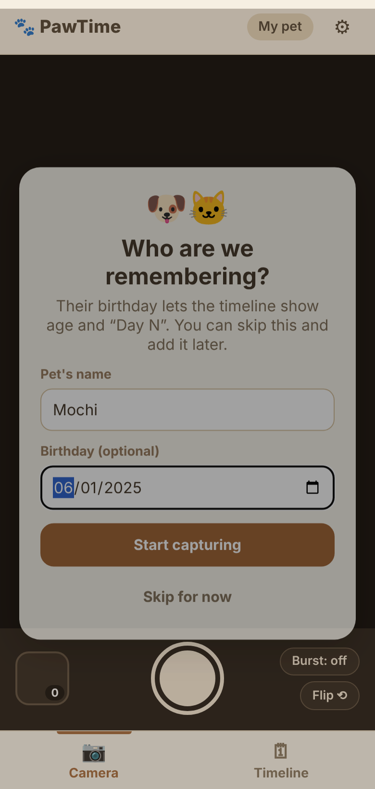
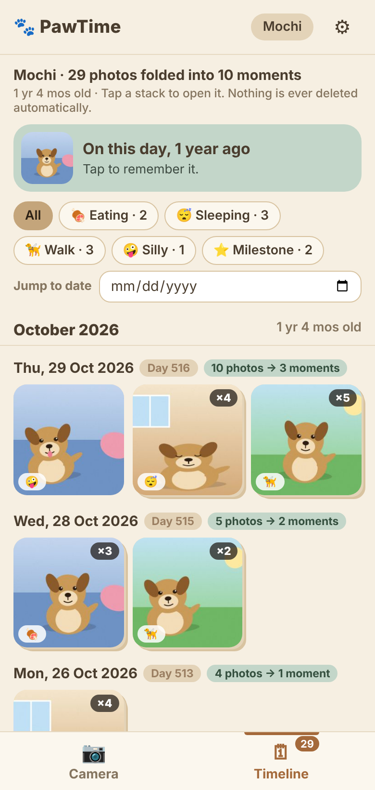
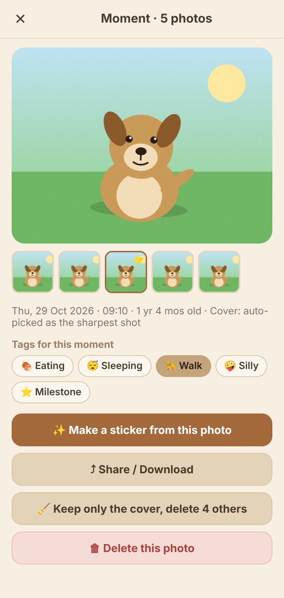
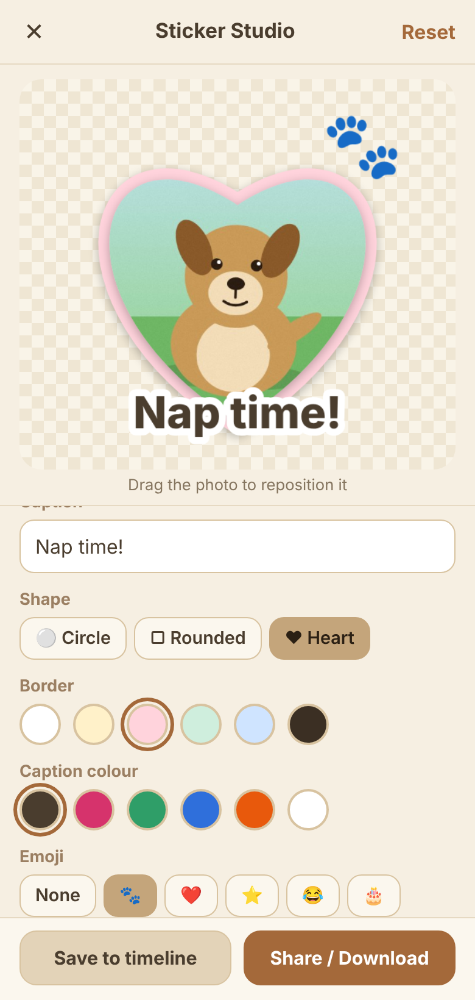

# PawTime 🐾

**Shoot to save, and your pet's photos organise themselves into a growth timeline.**

A phone-installable web app (PWA) for pet owners whose camera roll is full of dozens of near-identical pet photos they can't bear to delete, and can never find again.

- **Live app:** `https://<your-github-username>.github.io/<repo-name>/`  ← *(fill in after enabling GitHub Pages)*
- **Screen recording:** *(add a short phone recording here, e.g. `docs/demo.mp4`)*
- Course: SD5911, Assignment 3 (An interactive experience). Individual project.

| Welcome | Timeline | Moment | Sticker Studio |
|---|---|---|---|
|  |  |  |  |

*Screenshots use the app's built-in sample pet photos (drawn in code), not real animals.*

---

## The idea

I take photos of my pet all the time. The result: my phone album is stuffed with dozens of shots that barely differ, I can't make myself delete any of them, and when I want one specific moment it is buried among everyday photos.

PawTime's answer is **fold, don't delete**:

1. **Shoot inside the app.** Photos go into PawTime's own storage, not the phone gallery, so pet memories stay separate from screenshots and receipts.
2. **Similar shots fold into one "moment".** Photos taken close together that look alike become a single stack. The sharpest shot becomes the cover. Nothing is deleted unless you choose to.
3. **Everything lands on a growth timeline** (month → day → moment) that shows your pet's age and "Day N", filters by tag, and jumps to any date.
4. **Turn a favourite into a sticker** and share it.

### Intended user
Pet owners (roughly 20–35) who treat their pets as family, photograph them constantly, and like sharing stickers and memories on chat apps and social media.

### Main interaction (the loop)

| Step | User action | What the program does | Feedback |
|---|---|---|---|
| Shoot | Tap the shutter (or turn on Burst for 5 quick shots) | Shrinks the photo, computes its fingerprint and sharpness, saves it to IndexedDB | Flash, "Saved ✓", thumbnail and counter update |
| Tag (optional) | Tap one big button: Eating, Sleeping, Walk, Silly, Milestone | Adds the tag to everything just shot | Button highlights |
| Fold | *(automatic)* | Groups similar, nearby photos into moments, picks the sharpest as cover | Timeline says "16 photos → 4 moments" |
| Find | Scroll, tap a tag chip, or pick a date | Filters or scrolls the timeline | Instant, with a clear message if nothing matches |
| Keep or tidy | Open a stack: change cover, or "keep only the cover" | Updates or deletes (with confirmation) | Stack updates immediately |
| Make a sticker | Caption, shape, border, emoji, zoom, drag to reposition | Redraws a live preview on every change | Preview updates as you touch each control |
| Save or share | Save to timeline, or Share | Stores a PNG, or opens the phone share sheet (falls back to download) | "Saved ✓" / "Shared ✓" |

### Handling mistakes and interruptions
The mistake I chose to design for is **camera permission denied or no camera available**. Instead of a dead screen, the app explains what happened and offers three ways forward: *Try the camera again*, *Choose photos from my gallery*, or *Use sample pet photos* (so the whole app can be tried on a laptop with no camera at all).

Other cases handled: tapping the shutter repeatedly while a photo is saving (extra taps ignored); picking a non-image or corrupt file (clear message, no crash); double-clicking "Save to timeline" (saves once, button shows "Saved ✓"); sharing unsupported on the device (downloads the PNG instead); user cancelling the share sheet (no error); storage unavailable in private browsing (warning that photos will not persist); destructive actions (always ask for confirmation).

---

## Try it in 30 seconds (no camera needed)

1. Open the app, enter a name (or tap *Skip for now*).
2. If the camera is unavailable or you'd rather not allow it: tap **Use sample pet photos** (or ⚙ → *Add sample pet photos*).
3. You land on the **Timeline**: note the header "35 photos folded into 11 moments". Tap a stack with a ×5 badge.
4. Tap **Make a sticker from this photo**, type a caption, change the shape, and watch the preview update.
5. In ⚙ Settings, drag the **Similarity** slider and see how folding changes.

## How to run

There are **no dependencies and no build step**: plain HTML, CSS and JavaScript. You only need to serve the folder over `http://` (browsers block the camera and service worker on `file://`).

**Option A: Python (any computer with Python 3)**
```bash
cd pawtime
python3 -m http.server 8000      # on Windows: python -m http.server 8000
```
Open <http://localhost:8000>. The camera works on `localhost`.

**Option B: VS Code**
Install the *Live Server* extension, right-click `index.html` → *Open with Live Server*.

**Install on a phone (needs https)**
Browsers only allow the camera on https pages, so use the deployed GitHub Pages link:
- *iPhone (Safari):* Share → **Add to Home Screen**.
- *Android (Chrome):* ⋮ menu → **Install app** / **Add to Home screen**.

**Deploy (GitHub Pages):** push to GitHub, then *Settings → Pages → Build and deployment → Deploy from a branch → `main` / `(root)`*. The link appears after about a minute.

### Optional: automated smoke test
`tests/smoke_test.py` drives the app in headless Chromium with a fake camera (30 checks: shooting, burst, persistence, folding, cover choice, filter, viewer, stickers, share fallback, permission-denied path, bad files, service worker).
```bash
pip install playwright && python -m playwright install chromium
python3 -m http.server 8765 &        # serve the project root
python3 tests/smoke_test.py
```

---

## How the "smart" folding works (no AI model)

All logic runs on the phone, offline, for free. The core is `buildMoments()` in `app.js`:

- **Fingerprint (dHash):** shrink the photo to 9×8 greyscale; for each pixel record whether it is brighter than its right-hand neighbour. That gives 64 bits describing the photo's layout. Near-identical shots have near-identical bits.
- **Similarity:** the number of differing bits (Hamming distance). A photo joins the current moment if it was taken within the **time window** (default 20 min) *and* is within the **similarity threshold** (default 10 bits) of the previous photo.
- **Cover:** each photo gets a sharpness score (variance of a Laplacian filter); the sharpest becomes the cover unless the user pins another.
- Both thresholds are adjustable in ⚙ Settings, because "similar" is personal.

This is a rule-based algorithm, not machine learning. It cannot recognise breeds or understand what is in the picture.

## Project structure

```
index.html            app shell and screens
style.css             styles (warm palette from the PawTime concept)
app.js                all logic, in numbered sections (storage, folding, camera, timeline, stickers…)
manifest.json         makes the app installable
service-worker.js     lets the app open offline
icons/                app icons (generated, original)
docs/                 screenshots used in this README
tests/smoke_test.py   optional headless-browser test
PROCESS.md            how I built it, user trial, AI use
```

## Known limitations

- **Data lives only in this browser on this device.** Clearing browser data or uninstalling the app erases it. *Export backup (.json)* in Settings downloads a copy, but there is no import yet and no cloud backup.
- Web camera quality is lower than the phone's native camera app, and the camera only runs while the app is open and in front.
- Camera needs https (or localhost). On iPhone the app must be added to the Home Screen from Safari.
- Folding looks at overall layout, so two very different photos in the same room can occasionally be folded together, or one pet photo taken at a very different zoom may not be. Use the Similarity slider to tune.
- Stickers use a shape crop with a border, not automatic pet cut-out (that would need an AI model).
- Photos from a gallery use the file's modified time as the "taken" time, which is not always the real capture time. HEIC files may not open in every browser.
- Tested in headless Chromium and designed for mobile Safari/Chrome; I have not tested every phone model.

## Future work (from the original PawTime concept, not built here)
Cloud backup and accounts, AI pet videos, keepsake shop (baby teeth/fur), milestone reminders and notifications, breed/auto-tagging with an on-device model, background-removed stickers, import of a backup file.

## Credits

- **Concept:** *PawTime* was developed as a **group project** in SD5911's *Designing Multimedia Entertainment* tutorial by Fang Shuhan, Gonzalez Ceballos Moises, Han Songling, Huang Weiyu and Liu Yuchen. This repository is my **individual** implementation of one slice of that concept: the shoot-to-save **Memory Bank**, the **Growth Timeline**, and a simplified **Sticker Studio**. Not built here: AI video, keepsake shop, reminders, cloud backup. The colour palette follows the group's style board.
- **dHash:** the difference-hash idea for finding near-duplicate images is a well-known public technique; implemented here from scratch.
- **Sample pet photos:** drawn procedurally by `makeDemoPhoto()` in `app.js`. No external images or media are used.
- **Emoji** are rendered by the device's own emoji font. No external fonts, libraries, CDNs or APIs.
- **AI assistance:** code was written with the help of Claude (Anthropic). Details in [PROCESS.md](PROCESS.md).
